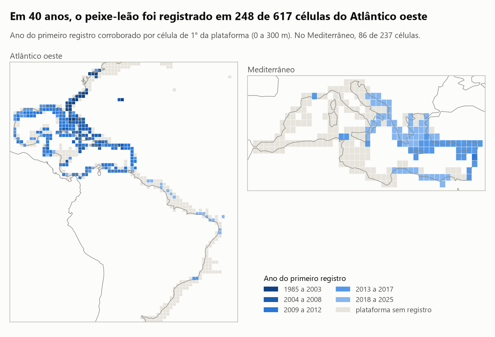
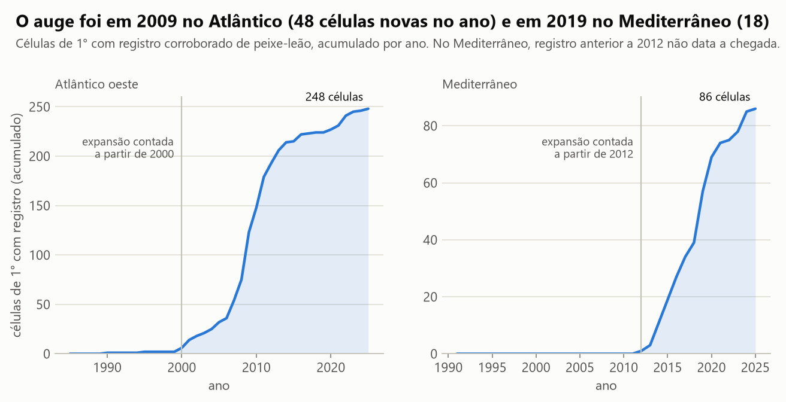
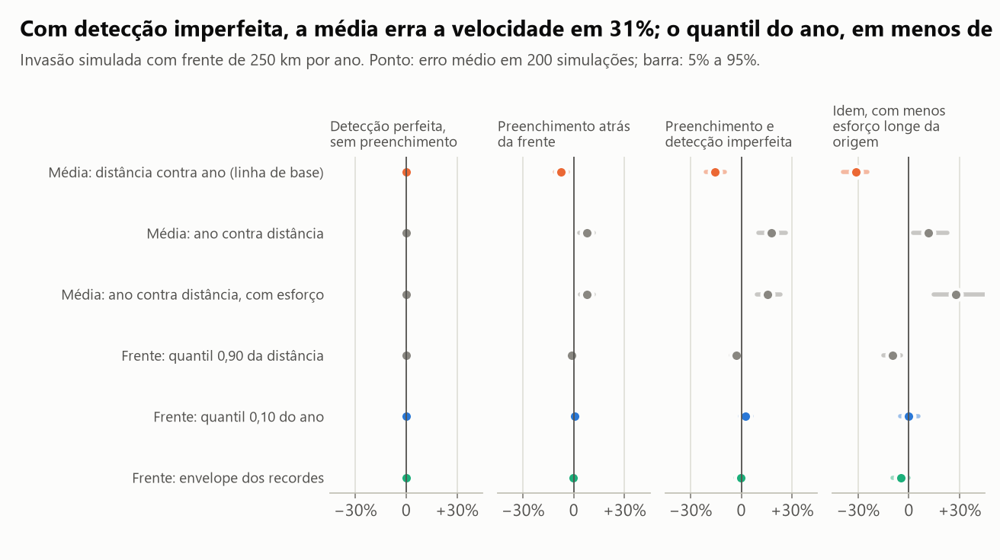
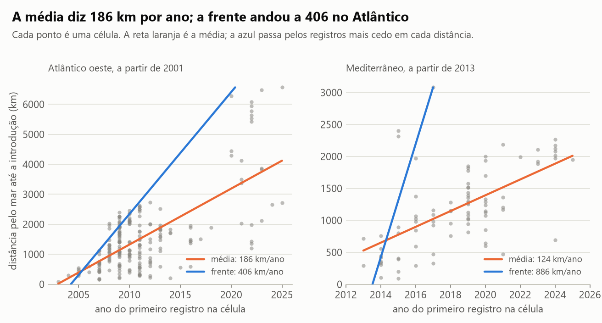
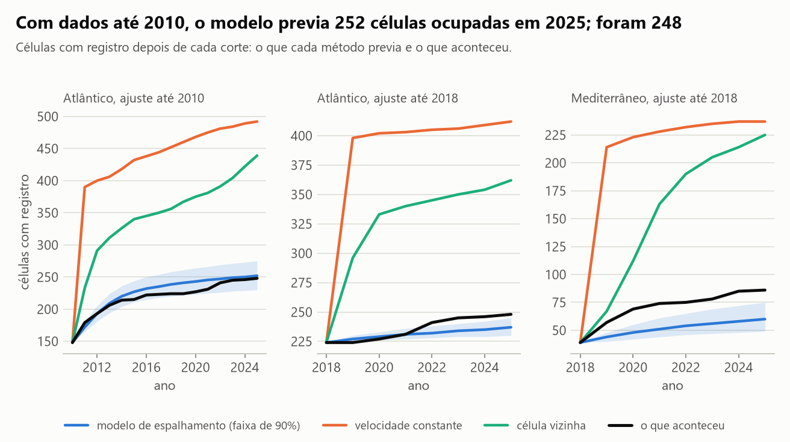
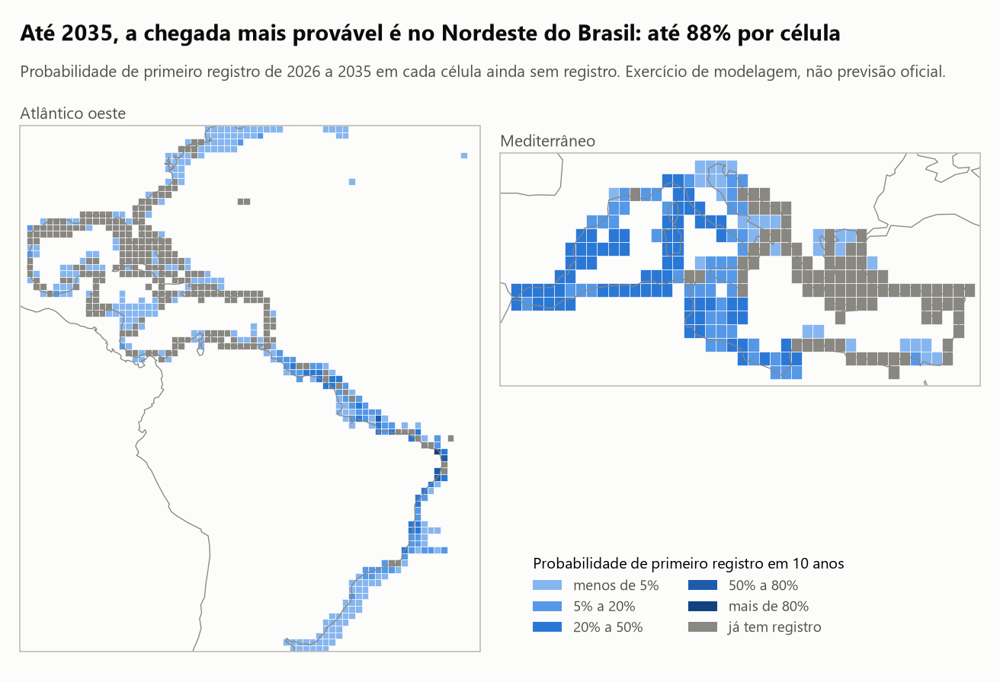

# Onde o peixe-leão vai chegar a seguir, e quando?

O peixe-leão (*Pterois volitans* e *P. miles*), nativo do Indo-Pacífico, invadiu o Atlântico oeste a partir da
Flórida e, pelo Canal de Suez, o Mediterrâneo. A decisão que este estudo informa é onde concentrar vigilância e
detecção precoce nos próximos anos.

**A resposta, com o que os dados públicos sustentam:** um modelo de espalhamento ajustado só com os registros até
2010 previa o primeiro registro no Brasil para **2017** (faixa de 90%: 2013 a 2024), e ele veio em **2020**. Para os
próximos dez anos, a chegada mais provável é no Nordeste do Brasil, entre Natal e Salvador, com até 88% de
probabilidade por célula de 1° (faixa de 78% a 94%). O modelo acerta melhor **quanto** a invasão cresce do que
**onde**: para dizer qual célula é a próxima, a regra "a vizinha da última ocupada" empata com ele.

É análise de dado público agregado, feita por um profissional de dados. Não é previsão oficial nem descoberta.

## Em 30 segundos

- **O dado central** é o ano do primeiro registro de peixe-leão em cada célula de 1° da plataforma continental
  (0 a 300 m): 248 de 617 células no Atlântico oeste e 86 de 237 no Mediterrâneo, a partir de 13.349 registros
  limpos de três fontes públicas (USGS NAS, GBIF e OBIS), coletados em 12/11/2026.
- **Dois terços dos "registros" do GBIF na área são ausências**: 29.992 de 45.200 são de censos que procuraram o
  peixe e não acharam. Quem baixa sem filtrar põe o peixe-leão nas Florida Keys em 1994.
- **"Avança X km por ano" depende da conta.** No Atlântico, a média dá 186 km por ano (IC 95%: 143 a 230); os
  estimadores de frente dão de 309 a 406. Numa invasão simulada com velocidade conhecida e detecção imperfeita, a
  média erra por 31% e o melhor estimador de frente, por menos de 1%.
- **O modelo de espalhamento ganha na quantidade e empata na ordem.** Ajustado até 2010, previu 252 células
  ocupadas em 2025 (faixa de 230 a 275); foram 248. A regra da vizinha previa 439 e a velocidade constante, 492.
  Em ordenar as células, AUC de 0,84 para o modelo e 0,84 para a regra da vizinha.
- **O modelo adiantou a chegada ao Brasil em três anos e errou o caminho.** Esperava a passagem pelas Guianas em
  2012; o primeiro registro lá é de 2021, depois do Brasil.
- **A primeira versão do modelo falhou** e está no estudo: sem uma fração de células não suscetíveis, previa 437
  células ocupadas em 2025.

## As figuras

### 1. A reconstrução da invasão



Cada quadrado é uma célula de 1° com plataforma continental; a cor é o ano do primeiro registro corroborado. No
Atlântico, o azul mais escuro está na costa leste dos EUA e nas Bahamas; o mais claro, no Brasil. No Mediterrâneo,
a ocupação vai do Levante para o oeste e sobe o Adriático.



A invasão ficou anos quase parada e depois disparou. No Atlântico, 2 células tinham registro corroborado até 1999;
o auge foi 2009, com 48 células novas num ano. Nos últimos cinco anos foram 21 células novas no Atlântico e 17 no
Mediterrâneo.

A cronologia dos dados confere com a publicada em 11 de 13 marcos. As duas diferenças (Dania e Israel) vêm da
regra de corroboração, explicada em "Como foi feito". A linha do Caribe mostra onde o dado bruto discorda da
literatura:

| Marco | Literatura | Dado público bruto | Registro corroborado |
|---|---|---|---|
| Flórida (Dania) | 1985 (Schofield 2009) | 1985 | 1990 |
| Bermudas | 2000 (Schofield 2009) | 2000 | 2000 |
| Bahamas | 2004 (Schofield 2009) | 2004 | 2004 |
| Mar do Caribe | 2007 (Schofield 2009) | **1996** | 2007 |
| Golfo do México | 2009 (Schofield 2010) | 2009 | 2009 |
| Venezuela | 2009 (Schofield 2010) | 2009 | 2009 |
| Brasil, registro isolado em Arraial do Cabo | 2014 (Ferreira et al. 2015) | 2014 | 2014 |
| Brasil, costa norte e Fernando de Noronha | 2020 (Luiz et al. 2021) | 2020 | 2020 |
| Brasil, Ceará e Piauí | 2022 (Soares et al. 2022) | 2022 | 2022 |
| Israel | 1991 (Golani e Sonin 1992) | 1991 | 2014 |
| Líbano | 2012 (Bariche et al. 2013) | 2012 | 2012 |
| Itália (Sicília) | 2016 (Azzurro et al. 2017) | 2016 | 2016 |
| Croácia (Adriático) | 2021 (Dragičević et al. 2021) | 2021 | 2021 |

O registro de 1996 no Caribe é uma observação de ciência cidadã em Guadalupe, 14 anos antes do registro seguinte
na mesma célula. No Mediterrâneo, 14 células têm registro público com data anterior a 2012 (o mais antigo fora de
Israel é de 1995, na região de Rodes). A literatura revisada só reconhece o de Israel nesse período, então os
outros 13 ficam fora da datação e aparecem na coluna `ano_bruto` do arquivo de resultado.

### 2. A velocidade da frente



Antes de medir a velocidade nos dados, cada estimador foi testado numa invasão simulada com frente de 250 km por
ano. Com detecção perfeita, todos acertam. Quando as células atrás da frente vão sendo ocupadas aos poucos, a média
já erra 8%. Com detecção imperfeita e menos observadores longe da origem, a média da distância por ano subestima em
31%; o quantil 0,10 do ano em cada distância (o registro mais cedo naquela distância) erra menos de 1%. Controlar
pelo esforço de observação numa regressão não resolveu: nesse cenário, superestimou em 28%.



| Estimador | Atlântico oeste (km/ano, IC 95%) | Mediterrâneo (km/ano, IC 95%) |
|---|---|---|
| Média: distância contra ano (linha de base) | 186 (143 a 230) | 124 (87 a 155) |
| Frente: quantil 0,90 da distância | 309 (267 a 325) | 83 (−26 a 184) |
| Frente: envelope dos recordes | 323 (284 a 376) | 653 (139 a 1.054) |
| Frente: quantil 0,10 do ano | 406 (373 a 594) | 886 (252 a 1.983) |

No Atlântico, os estimadores de frente ficam entre 309 e 406 km por ano, perto e acima dos 250 a 300 km por ano
publicados para a frente sul entre 2004 e 2009 (Côté et al. 2013). A velocidade não foi constante: a frente ficou
em 2.735 km de 2012 a 2019 e saltou para 6.283 km em 2020, com os registros no Brasil. No Mediterrâneo, os
intervalos vão de negativos a quase 2.000 km por ano: os dados não sustentam a ideia de uma frente única ali.

O viés de detecção que a simulação supõe não apareceu com clareza nos dados reais: a correlação entre o esforço de
observação da célula e o atraso do primeiro registro é 0,05 no Atlântico (p = 0,51) e 0,08 no Mediterrâneo
(p = 0,45).

### 3. A validação no tempo



O modelo é ajustado com o que se sabia até o corte e simulado daí para a frente. No corte de 2010, a faixa de 90%
contém o que aconteceu durante os 15 anos seguintes. Nos cortes de 2018 ele erra para baixo: no Atlântico previa
237 células em 2025 (faixa de 230 a 245) e foram 248; no Mediterrâneo previa 60 (49 a 75) e foram 86. As duas
regras simples erram muito para cima, porque dão como ocupada toda célula ao alcance da frente.

**O teste difícil, a foz do Amazonas e o Brasil:**

| Ajuste até | O que o modelo dizia sobre o Brasil | Velocidade constante | Célula vizinha | O que aconteceu |
|---|---|---|---|---|
| 2010 | 1º registro em 2017 (2013 a 2024); 85% de chance até 2020 | 2017 | 2022 | 2020 |
| 2018 | 19% de chance até 2020; 60% até 2025; mediana em 2024 | 2035 | 2028 | 2020 |

Com dados até 2010, as três contas erraram o ano por dois ou três anos. A diferença está no caminho: o modelo
esperava o primeiro registro nas Guianas em 2012 (2011 a 2015) e ele só veio em 2021, depois dos registros no
Amapá e em Fernando de Noronha. O modelo não tem a pluma do Amazonas e do Orinoco nem as correntes. Com dados até
2018, depois de seis anos de frente parada, o modelo passou a atrasar: dava 19% de chance ao que aconteceu dois
anos depois. Luiz et al. (2013) já escreviam que a pluma deveria atrasar a invasão sem bloqueá-la.

### 4. A previsão para 2026 a 2035



| Célula (canto sudoeste) | Referência aproximada | Chegada em 5 anos | Chegada em 10 anos (faixa de 90%) |
|---|---|---|---|
| 6°S, 36°O | região de Natal | 64% | 88% (78% a 94%) |
| 9°S, 36°O | sul de Pernambuco | 45% | 72% (59% a 82%) |
| 10°S, 36°O | região de Maceió | 38% | 63% (54% a 74%) |
| 1°S, 45°O | litoral do Maranhão | 29% | 55% (43% a 70%) |
| 13°S, 39°O | região de Salvador | 16% | 42% (33% a 51%) |
| 17°S, 40°O | região de Abrolhos | 10% | 28% (19% a 40%) |

No Atlântico, o modelo espera 19 células novas em dez anos (faixa de 11 a 29), 14 delas no Brasil. Ao sul de 13°S,
a chance de pelo menos um registro novo corroborado em dez anos é de 89% (82% a 96%), mas nenhuma célula passa de
37%: o modelo diz que deve chegar, não onde.

No Mediterrâneo ocidental o mapa precisa ser lido com desconfiança. O modelo espera 20 células novas a oeste de
12°L em dez anos, com no máximo 46% por célula. Só que essa probabilidade vem quase toda do termo de saltos, não da
vizinhança, e a validação pesa contra: ajustado até 2018, o mesmo modelo previa 5,7 células novas ali até 2025 e
não houve nenhuma corroborada. O limite térmico estimado também muda com o corte (15,7 °C com dados até 2018;
14,1 °C com dados até 2025), e as águas do oeste ficam nessa faixa.

## Como foi feito

1. **Coleta.** Registros do gênero *Pterois* no USGS NAS, no GBIF e no OBIS, nas caixas dos dois teatros. Do GBIF
   só os registros de presença. Relevo do ETOPO1 e temperatura da superfície do mar do OISST (NOAA), via ERDDAP.
2. **Limpeza.** De 40.376 registros baixados ficam 13.349: saem os sem coordenada ou ano, os de fora da área
   invadida (Pacífico, Mar Vermelho, Mar Negro), os espécimes vivos de coleção, as duplicatas entre fontes (25 mil;
   o NAS é republicado dentro do GBIF e do OBIS), as coordenadas em terra e os pontos longe da plataforma.
3. **Corroboração.** Um registro só data a chegada a uma célula se houver outro na mesma célula ou numa vizinha,
   no mesmo ano ou nos três seguintes. A regra é cega para a literatura: tira o registro de 1996 em Guadalupe e
   também o de 1985 em Dania e o de 1991 em Israel, que a literatura confirma e que ficaram anos sem sucessor. No
   Mediterrâneo, registro anterior a 2012 não data a chegada (essa regra, sim, vem da literatura).
4. **Geografia.** Células de 1° com pelo menos 2% de plataforma (0 a 300 m). A distância entre células é medida
   pelo mar, pelo caminho mais curto numa malha de 0,5° que contorna a terra.
5. **Velocidade.** Seis estimadores, cada um com intervalo por bootstrap de células, testados antes numa invasão
   simulada. A regressão de quantis é resolvida como programa linear. No Atlântico, a frente é medida no ramo que
   vai para o sul e o oeste; o ramo norte, pela costa leste dos EUA, é levado pela Corrente do Golfo e não se
   sustenta no inverno ao norte do Cabo Hatteras (Kimball et al. 2004).
6. **Modelo de espalhamento.** A cada ano, a célula suscetível e sem registro ganha um com probabilidade
   1 − exp(−risco), em que risco = (fundo + contágio × pressão) × (1 + esforço)^elasticidade, e a pressão soma
   exp(−distância / alcance) sobre as células já ocupadas. Cada célula é suscetível com probabilidade dada por uma
   logística do habitat (registros acumulados de outros peixes recifais) vezes uma logística da temperatura do mês
   mais frio. Sete parâmetros, por máxima verossimilhança; incerteza pela hessiana.
7. **Validação.** Ajuste com dados até 2010 e até 2018 (Atlântico) e até 2018 (Mediterrâneo); simulação dos anos
   seguintes com o esforço congelado no valor do corte; comparação com o que aconteceu.
8. **Previsão.** Reajuste com tudo até 2025 e 2.500 simulações de 2026 a 2035, sorteando também os parâmetros.

O esforço de observação é a contagem, por célula e ano, de registros de 11 famílias de peixes recifais e costeiros
no GBIF (5,6 milhões de registros, consultados só como contagem).

## Comparação com a alternativa simples

Células ainda sem registro no corte; o alvo é ter o primeiro registro em até cinco anos. AUC mede a ordem (0,5 é
sorteio); Brier mede o erro da probabilidade (menor é melhor); a última coluna é o erro médio no ano de chegada das
células que chegaram até 2025.

| Corte | Método | AUC (IC 95%) | Brier | Células previstas / colonizadas | Erro no ano (anos) |
|---|---|---|---|---|---|
| Atlântico, 2010 | Modelo de espalhamento | 0,84 (0,77 a 0,89) | 0,095 | 79 / 67 | 4,1 |
| | Célula vizinha | 0,84 (0,79 a 0,88) | 0,284 | 192 / 67 | 2,8 |
| | Velocidade constante | 0,76 (0,72 a 0,79) | 0,471 | 284 / 67 | 2,8 |
| | Modelo sem fração suscetível (1ª versão) | 0,83 (0,77 a 0,87) | 0,183 | 166 / 67 | 2,6 |
| Atlântico, 2018 | Modelo de espalhamento | 0,77 (0,69 a 0,83) | 0,053 | 10 / 21 | 3,2 |
| | Célula vizinha | 0,60 (0,48 a 0,71) | 0,338 | 126 / 21 | 3,8 |
| | Velocidade constante | 0,50 (0,40 a 0,59) | 0,486 | 182 / 21 | 4,0 |
| | Modelo sem fração suscetível (1ª versão) | 0,52 (0,41 a 0,65) | 0,111 | 68 / 21 | 2,5 |
| Mediterrâneo, 2018 | Modelo de espalhamento | 0,78 (0,69 a 0,86) | 0,148 | 18 / 39 | 1,6 |
| | Célula vizinha | 0,74 (0,66 a 0,82) | 0,652 | 166 / 39 | 1,2 |
| | Velocidade constante | 0,57 (0,55 a 0,61) | 0,793 | 196 / 39 | 1,7 |
| | Modelo sem fração suscetível (1ª versão) | 0,79 (0,71 a 0,86) | 0,241 | 100 / 39 | 1,4 |

Leitura, com todas as letras:

- **Na ordem das células, o modelo empata com a regra da vizinha** em dois dos três testes. No Atlântico de 2018
  fica à frente (0,77 contra 0,60), com intervalos que ainda se tocam.
- **Na probabilidade, o modelo ganha sempre**: o erro de Brier é de três a seis vezes menor, porque as regras
  simples não sabem dizer que uma célula não vai ser ocupada.
- **No ano de chegada de cada célula, o modelo perde** no Atlântico de 2010 (4,1 anos contra 2,8) e no
  Mediterrâneo (1,6 contra 1,2).
- **A velocidade constante é a pior** em AUC e em Brier nos três testes.
- O modelo erra a quantidade nos cortes de 2018: previu a metade do que veio.

## Onde este estudo falha

- **A validação do modelo final não é um teste intocado.** A primeira versão (sem fração suscetível) previa que
  quase toda a plataforma seria ocupada. O termo foi acrescentado depois de ver esse erro, e a entrada da
  temperatura foi decidida pelo erro de Brier nas mesmas validações. Os números do modelo final são, portanto,
  otimistas. O teste limpo é a previsão de 2026 a 2035, que ainda não aconteceu.
- **O modelo prevê registro, não população.** Um peixe solto de aquário e fotografado conta como chegada. Seis
  células em cada mar só têm registro isolado e ficaram como "sem registro".
- **Sem correntes, sem pluma do Amazonas, sem tipo de fundo.** A distância pelo mar trata igual o caminho a favor e
  contra a corrente. É a razão provável do erro nas Guianas.
- **O limite térmico estimado não é o fisiológico.** No Atlântico, o ajuste dá 7,1 °C (5,8 a 8,4), abaixo dos
  10 °C letais de laboratório, porque 6 células com registro têm mês mais frio abaixo de 10 °C: são os peixes
  levados no verão para o norte de Hatteras. A temperatura usada é a da superfície, média mensal de 2011 a 2020 em
  grade de 0,5°; o peixe vive no fundo.
- **O Mediterrâneo ocidental** está descrito acima: a previsão ali depende do termo de saltos e não passou na
  validação. Os registros públicos da região de Marselha em 2017 entram como fonte e não têm confirmação na
  literatura revisada, que dá como limite oeste um indivíduo isolado no Mar de Alborão (Bottacini et al. 2024).
- **Arraial do Cabo** foi tratado como registro isolado que não espalha, com base em Luiz et al. (2021). Se houver
  população ali, a previsão para o Sudeste está subestimada.
- **Esforço de observação medido hoje.** As contagens do GBIF incluem registros antigos digitalizados depois do
  corte; a validação usa esforço que, em parte, não estava disponível na época.
- **Células de 1° e distâncias aproximadas.** A malha de 0,5° superestima a distância em até uns 8% fora das
  direções principais, e a regra de identificação da espécie é a de cada fonte: *P. volitans* e *P. miles* não são
  separados (o NAS já os registra juntos).
- **Escolhas minhas que mudam números:** o início da expansão (2000 e 2012), a janela de três anos da
  corroboração, o ramo em que a frente é medida, os cortes de validação.

## O que faltaria para isto virar contribuição científica

- Revisão por quem estuda a invasão: os registros isolados e os anteriores a 2012 no Mediterrâneo precisam ser
  conferidos um a um na fonte, não por regra.
- Validação da identificação e do estado de cada registro (espécime, foto, relato), e separação entre indivíduo
  isolado e população estabelecida.
- Dado de campo com esforço conhecido: censos com ausência registrada, que aqui foram descartados, são justamente
  o que permitiria estimar a detecção em vez de supor.
- Correntes e conectividade larval (um modelo de dispersão de partículas), temperatura de fundo e mapa de habitat
  recifal no lugar dos indicadores usados.
- Comparação formal com os modelos já publicados, como o autômato celular de Johnston e Purkis (2011), nos mesmos
  dados e nos mesmos cortes.
- Um teste realmente fora da amostra: registrar a previsão hoje e conferi-la contra os registros de 2026 em diante.

## Para quem isto pode ser útil

- **Quem planeja monitoramento ou detecção precoce** (gestores de unidades de conservação marinhas, grupos de
  pesquisa, programas de ciência cidadã com mergulhadores e pescadores): a lista de células ordenada por
  probabilidade serve para priorizar onde olhar, não para afirmar que o peixe vai chegar.
- **Quem trabalha com dado de ocorrência**: a regra de corroboração e a contagem das ausências do GBIF são
  reaproveitáveis em outras espécies invasoras.

O arquivo reutilizável é [`reports/probabilidade_de_chegada.csv`](reports/probabilidade_de_chegada.csv), com uma
linha por célula (854 células):

| Coluna | Significado |
|---|---|
| `celula`, `teatro`, `regiao` | Identificador (`A_S06_W036` = Atlântico, 6°S a 5°S, 36°O a 35°O), teatro e recorte aproximado |
| `lat_sul`, `lon_oeste` | Canto sudoeste da célula de 1° |
| `ocupada` | Verdadeiro se há registro corroborado até 2025 |
| `ano_primeiro_registro`, `ano_bruto` | Ano do primeiro registro corroborado e do primeiro registro de qualquer tipo |
| `prob_5_anos`, `prob_10_anos` | Probabilidade de primeiro registro até 2030 e até 2035 (vazio se já ocupada) |
| `..._inf`, `..._sup` | Faixa de 90% vinda da incerteza dos parâmetros |
| `prob_suscetivel` | Probabilidade de a célula poder vir a ter registro, depois de vista a história |
| `tmin_c`, `limite_termico` | Temperatura do mês mais frio (superfície) e posição em relação a 10 °C e 16,1 °C (Kimball et al. 2004) |
| `distancia_origem_km` | Distância pelo mar até o ponto de introdução |

**Ressalva:** é um exercício de modelagem com dado público, sem revisão por especialista. Não é previsão oficial e
não substitui o monitoramento.

## Dados, licenças e referências

- **USGS NAS:** U.S. Geological Survey. 2026. Nonindigenous Aquatic Species Database. Gainesville, Florida.
  Consultado em 12/11/2026. Dado do governo dos EUA, em domínio público.
- **GBIF:** GBIF.org, busca de ocorrências do gênero *Pterois* pela API em 12/11/2026. A busca pela API não gera
  DOI de download; para citar formalmente, o GBIF pede o registro de um conjunto de dados derivado.
- **OBIS:** OBIS (2026). Ocean Biodiversity Information System. Intergovernmental Oceanographic Commission of
  UNESCO. <https://obis.org>. Consultado em 12/11/2026.
- **NOAA:** ETOPO1 (relevo) e OISST v2.1 (temperatura da superfície do mar), via ERDDAP do CoastWatch.
- **Natural Earth** 1:110m (linha de costa dos mapas), domínio público.

GBIF e OBIS reúnem 94 conjuntos de dados com licenças diferentes (CC0, CC BY, CC BY-NC). Este repositório
redistribui só agregados por célula, para estudo não comercial; nenhum registro individual é versionado. O código
é MIT.

Referências, todas conferidas por busca (texto integral, resumo ou registro da revista):

- Azzurro E. et al. (2017). Range expansion of the common lionfish *Pterois miles* in the Mediterranean Sea: an
  unwanted new guest for Italian waters. *BioInvasions Records* 6(2): 95–98. doi:10.3391/bir.2017.6.2.01
- Bariche M., Torres M., Azzurro E. (2013). The presence of the invasive lionfish *Pterois miles* in the
  Mediterranean Sea. *Mediterranean Marine Science* 14(2): 292–294. doi:10.12681/mms.428
- Bottacini D. et al. (2024). Lionfish (*Pterois miles*) in the Mediterranean Sea: a review of the available
  knowledge with an update on the invasion front. *NeoBiota* 92: 233–257. doi:10.3897/neobiota.92.110442
- Côté I.M., Green S.J., Hixon M.A. (2013). Predatory fish invaders: insights from Indo-Pacific lionfish in the
  western Atlantic and Caribbean. *Biological Conservation* 164: 50–61. doi:10.1016/j.biocon.2013.04.014
- Dragičević B. et al. (2021). New record of *Pterois* cf. *miles* from the eastern middle Adriatic Sea (Croatian
  waters): northward expansion. *Acta Ichthyologica et Piscatoria* 51(4): 379–383. doi:10.3897/aiep.51.75811
- Ferreira C.E.L. et al. (2015). First record of invasive lionfish (*Pterois volitans*) for the Brazilian coast.
  *PLoS ONE* 10(4): e0123002. doi:10.1371/journal.pone.0123002
- Gilbert M., Liebhold A. (2010). Comparing methods for measuring the rate of spread of invading populations.
  *Ecography* 33(5): 809–817. doi:10.1111/j.1600-0587.2009.06018.x
- Golani D., Sonin O. (1992). New records of the Red Sea fishes, *Pterois miles* and *Pteragogus pelycus*, from the
  eastern Mediterranean Sea. *Japanese Journal of Ichthyology* 39(2): 167–169. doi:10.11369/jji1950.39.167
- Johnston M.W., Purkis S.J. (2011). Spatial analysis of the invasion of lionfish in the western Atlantic and
  Caribbean. *Marine Pollution Bulletin* 62(6): 1218–1226. doi:10.1016/j.marpolbul.2011.03.028
- Kimball M.E. et al. (2004). Thermal tolerance and potential distribution of invasive lionfish (*Pterois
  volitans/miles* complex) on the east coast of the United States. *Marine Ecology Progress Series* 283: 269–278.
  doi:10.3354/meps283269
- Luiz O.J. et al. (2013). Perspectives for the lionfish invasion in the South Atlantic: are Brazilian reefs
  protected by the currents? *Marine Ecology Progress Series* 485: 1–7. doi:10.3354/meps10383
- Luiz O.J. et al. (2021). Multiple lionfish (*Pterois* spp.) new occurrences along the Brazilian coast confirm the
  invasion pathway into the Southwestern Atlantic. *Biological Invasions* 23: 3013–3019.
  doi:10.1007/s10530-021-02575-8
- Schofield P.J. (2009). Geographic extent and chronology of the invasion of non-native lionfish in the Western
  North Atlantic and Caribbean Sea. *Aquatic Invasions* 4(3): 473–479. doi:10.3391/ai.2009.4.3.5
- Schofield P.J. (2010). Update on geographic spread of invasive lionfishes in the Western North Atlantic Ocean,
  Caribbean Sea and Gulf of Mexico. *Aquatic Invasions* 5(Suppl. 1): S117–S122. doi:10.3391/ai.2010.5.S1.024
- Soares M.O. et al. (2022). Lionfish on the loose: *Pterois* invade shallow habitats in the tropical southwestern
  Atlantic. *Frontiers in Marine Science* 9: 956848. doi:10.3389/fmars.2022.956848

Este estudo continua a ideia de
[`vida-marinha-costa-brasileira`](https://github.com/ghitflux/vida-marinha-costa-brasileira): lá, o esforço de
coleta explicava a riqueza registrada; aqui, ele entra no modelo como condição para haver registro.

## Como rodar

Pré-requisito: [`uv`](https://docs.astral.sh/uv/getting-started/installation/).

```bash
uv sync
uv run python scripts/rodar_analise.py   # regera reports/ a partir do extrato em data/ (cerca de 3 minutos)
uv run pytest -q -p no:cacheprovider     # 43 testes, não dependem dos dados
uv run python scripts/baixar_dados.py    # opcional: recoleta tudo (20 a 40 minutos) e regrava data/
```

`data/` traz o extrato agregado de que a análise precisa para rodar sem rede; os arquivos brutos (56 MB) ficam em
`data/brutos/`, fora do git. O notebook [`analise.ipynb`](analise.ipynb) conta a história com as tabelas; ele é
montado por `scripts/montar_notebook.py`.

```text
├── analise.ipynb
├── data/                      # extrato agregado: células, registros e esforço por célula e ano, malha do mar
├── src/peixe_leao/
│   ├── coleta.py, dados.py    # download, limpeza, corroboração e agregação
│   ├── geografia.py           # teatros, células e distância pelo mar
│   ├── frente.py              # estimadores de velocidade, regressão de quantis, invasão simulada
│   ├── espalhamento.py        # modelo, verossimilhança, simulação, linhas de base e métricas
│   ├── analise.py             # orquestra cada tabela
│   └── graficos.py, estilo.py, site.py
├── scripts/                   # baixar_dados.py, rodar_analise.py, montar_notebook.py
├── tests/                     # 43 testes (pytest)
└── reports/                   # resultados.json, probabilidade_de_chegada.csv e figuras
```

## Como este estudo foi feito

Este estudo foi construído com assistência de IA (Claude Code, da Anthropic), usada como par de programação.
Declaro a divisão do trabalho porque ela importa para quem avalia:

- **Meu:** a escolha da frente (ciência de dados marinhos é o que mais quero estudar), o critério dos estudos
  (escopo global, espécies e lugares raros, utilidade para preservação), a leitura crítica dos resultados e a
  decisão do que publicar e do que declarar como limitação. Não sou biólogo: sou profissional de dados estudando
  o mar com dado público.
- **Com o assistente:** a formulação da pergunta, a escolha das bases e do método, a implementação do código, dos
  testes e dos gráficos, e a redação, que revisei.
- **Como conferir:** todo número deste README sai de `reports/resultados.json`, gerado por
  `scripts/rodar_analise.py`. Os testes em `tests/` conferem as funções de método contra casos de resposta
  conhecida.

A responsabilidade pelo que está escrito aqui é minha. Se você é da área e encontrou um erro, abra uma issue: é
o tipo de correção que eu quero receber.

## Summary (English)

Where will the invasive lionfish (*Pterois volitans* / *P. miles*) show up next, and when? Using 13,349 cleaned
public occurrence records (USGS NAS, GBIF, OBIS; collected 12 Nov 2026) on a grid of one-degree continental-shelf
cells, this study reconstructs the invasion in the western Atlantic and the Mediterranean, measures front speed,
and fits a simple spread model that is validated forward in time against two naive rules. Two thirds of GBIF
"records" in the area turned out to be absence records. Front-speed estimators differ widely on the same data
(186 km/yr for the mean versus 309 to 406 for front estimators in the Atlantic), and a simulated invasion with a
known speed shows the mean is biased by 31% under imperfect detection. A spread model fitted only to data through
2010 predicted 252 occupied cells by 2025 (248 observed) and the first Brazilian record in 2017 (90% range 2013 to
2024; it came in 2020), but it only ties with a nearest-neighbour rule at ranking which cells come next
(AUC 0.84 vs 0.84) and it expected the Guianas to be reached nine years before they were. The ten-year forecast
puts the highest arrival probabilities along northeastern Brazil (up to 88% per cell). The first version of the
model failed and is reported; the final model was revised after seeing validation results, so those results are
optimistic. This is a modelling exercise on public data by a data professional, not an official forecast. Code,
notebook and README are in Portuguese.
